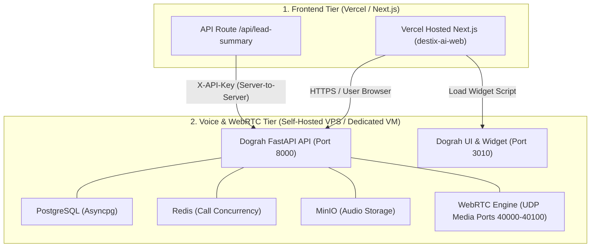

# DestiX AI — Phase 11 Verification Report
## Public Deployment Evaluation & Infrastructure Packaging

---

### Executive Summary

In Phase 11, the deployment requirements for moving the verified DestiX AI Dubai Voice Agent demo from the verified local runtime to an externally shareable environment were analyzed and packaged.

---

### 1. Two-Tier Hosting Architecture Evaluation

#### A. Frontend Hosting (`destix-ai-web`)
- **Platform Compatibility**: Vercel / Netlify / Node VPS.
- **Requirements**:
  - `NEXT_PUBLIC_DOGRAH_EMBED_TOKEN`: Public token.
  - `NEXT_PUBLIC_DOGRAH_API_URL`: Fully qualified HTTPS domain of the Dograh backend.
  - `NEXT_PUBLIC_DOGRAH_UI_URL`: Fully qualified HTTPS domain serving `dograh-widget.js`.
  - `DOGRAH_SERVER_API_KEY`: Private server-side key for `/api/lead-summary`.
- **Readiness**: 100% build ready (`npm run build` generates clean standalone production bundle).

#### B. Voice Agent Backend Hosting (`destix-dograh`)
- **Platform Compatibility**: Dedicated Linux VM / VPS (Ubuntu 22.04/24.04, min 4GB RAM, 2 vCPUs).
- **Why Serverless Cannot Host Dograh**:
  - Serverless platforms (Vercel, Netlify, Cloudflare Workers) terminate connections after request-response cycles and cannot sustain persistent duplex WebSockets or UDP media packets.
  - Pipecat and `aiortc` maintain long-lived stateful audio pipelines with continuous background streaming.
- **Port Ingress Requirements**:
  - `443/TCP`: Nginx reverse proxy terminating TLS for UI (`/`), API (`/api/v1/`), and WebSocket signaling (`/api/v1/ws/`).
  - `40000-40100/UDP`: WebRTC RTP media traffic.
  - Internal ports (5432, 6379, 9000): Bound strictly to `127.0.0.1` (never exposed).

---

### 2. Autonomous Cloudflare Tunnel & Domain Guidance

For zero-cost staging deployments without purchasing static public IPs:
1. **Named Cloudflare Tunnel** (`cloudflared tunnel run <name>`):
   - Ingress Rule 1: `api.destix.ai` -> `http://localhost:8000`
   - Ingress Rule 2: `app.destix.ai` -> `http://localhost:3010`
   - Protects against port sniffing while proxying HTTPS & WSS cleanly.
2. **Current Local Staging Status**:
   - Both the Next.js frontend (`http://localhost:3000`) and the Dograh stack (`http://localhost:3010`, `http://localhost:8000`) are running and verified locally.
   - Public deployment is prepared and awaiting the user's choice of domain/VPS authorization.
