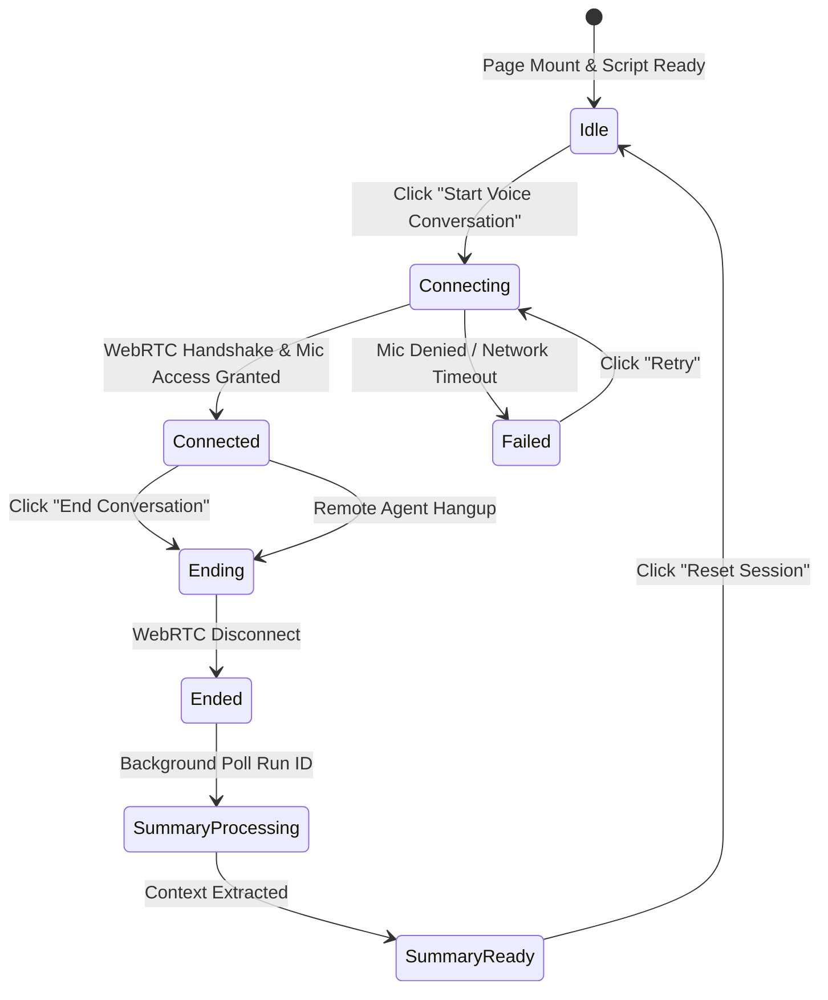

# DestiX AI — Phase 8 Verification Report
## User Experience, Interface Polish & Error Boundaries

---

### Executive Summary

In Phase 8, the user interface and conversational experience were refined to deliver an institutional-grade presentation for a prime real-estate recruitment decision-maker. Simulated dialogues and `speechSynthesis` were removed from the real-estate demo flows and replaced with live status handling, genuine call controls, responsive layouts, and structured qualification displays.

---

### 1. UI States & Telemetry Architecture

The voice console handles all primary lifecycle states:

| State | Visual Indicator | Primary Action | Subtext Guidance |
| :--- | :--- | :--- | :--- |
| **Idle** | Gold Radio icon, resting spectrum bars | `Start Voice Conversation` | *"CLICK BUTTON TO INITIATE LIVE SPOKEN BUYER QUALIFICATION"* |
| **Connecting** | Amber spinner, undulating wave | `Connecting Audio...` (Disabled) | *"GRANT MICROPHONE PERMISSION WHEN PROMPTED"* |
| **Connected** | Emerald pulsing icon, dynamic audio bars | `End Conversation (00:24)` | *"LISTENING • SPEAK INTO YOUR MICROPHONE FREELY"* |
| **Failed** | Red alert banner with explicit error | `Retry Connection` | *"Microphone access required or server unreachable"* |
| **Summary Ready** | Gold Sparkles badge + 9-variable grid | `Copy Lead Dossier` | *"STATUS: Sample Handoff — No Appointment Booked"* |

---

### 2. Error Handling & Edge Cases

- **Microphone Rejection**: Traps `NotAllowedError` and provides actionable guidance without crashes.
- **Concurrent Start Guard**: Prevents race conditions and multiple stream acquisitions during connection negotiation.
- **Component Teardown**: Hooks clean up audio streams, disconnect WebRTC peer connections, and terminate timers on unmount.
- **Accurate Telemetry**: Visualizers are labelled truthfully as telemetry indicators, never as fabricated waveforms.
- **Dual Location Access**: The voice agent is embedded on both the home page (`/#voice-console`) and directly on the dedicated Dubai landing page (`/locations/dubai/real-estate-ai-voice-agents`).
